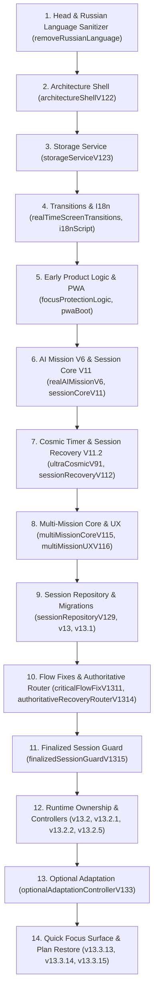

# Focus Mode+ v14.1 — Архитектура приложения (Architecture)

> **Baseline Version:** v14 Recovery Merge  
> **Stable Tag:** `v14-recovery-merge-stable`  
> **Production Branch:** `production`  
> **Stable Commit:** `81809e9d1b784d5cbf2fdef3418c77f7da45ee6c`  
> **Статус документа:** Фактическая архитектура стабильной версии v14

---

## 1. Архитектурная парадигма и распределение (Single-File Distribution)

Focus Mode+ в версии v14 Recovery Merge представляет собой монолитное веб-приложение, распространяемое в виде единого автономного HTML-файла (`index.html`), связанного с манифестом PWA (`manifest.webmanifest`) и сервисом кэширования (`service-worker.js`).

### Принципы распределения
* **Zero-Build Runtime:** Приложение не использует сборщики (Webpack, Vite, Rollup) на этапе рантайма и исполняется напрямую в браузерном движке.
* **Single Execution Context:** Стили (Tailwind CSS через CDN + кастомные `<style>`), HTML-разметка экранов (`.app-screen`), иконки (Lucide через unpkg) и все функциональные скрипты исполняются в едином глобальном контексте `window`.
* **Layered Script Stack:** Развитие приложения происходило эволюционным наложением версионных слоев скриптов (от v6/v7 до v13.3.15). Каждый новый слой стабилизирует, оборачивает или переопределяет предшествующие обработчики без физического удаления легаси-разметки.

---

## 2. Модульная шина и пространство имен FocusModeApp

Центральным узлом архитектурной структуризации является глобальное пространство имен `window.FocusModeApp`, инициализируемое скриптом `architectureShellV122` (строка 904).

```
window.FocusModeApp
├── version: "13.2.5"
├── name: "Architecture Stabilization"
├── architecture: { distribution: "single-html", mode: "compatibility", ... }
├── core
│   ├── lifecycle: { phase: "architecture-stable", ready: true, ... }
│   ├── modules: Map (реестр изолированных модулей)
│   ├── registerModule(name, definition, metadata)
│   ├── getModule(name)
│   ├── hasModule(name)
│   └── listModules()
├── state
│   └── recoveryRouterV1314: { bootEpoch, resumeInFlight, resumedSessionId, route }
├── services
│   ├── storage (StorageService: getText, setText, getJSON, setJSON, backup, remove)
│   ├── sessionPersistence (terminalCommit, refreshConsumers)
│   └── recoveryPersistence (readCandidate, inspect)
├── repositories
│   ├── sessions (SessionRepository: active, last, history)
│   └── missions (MissionRepository: loadStore, getAll, getActive, getById, ...)
├── features
│   ├── missionFlow (координатор потока миссий v13.2.2)
│   ├── optionalAdaptation (контроллер AI-адаптации и пропуска v13.3)
│   └── planDurationProtectionRestore (контроллер верстки плана v13.3.15)
└── compatibility
    ├── legacyRuntimeAuthoritative: true
    ├── sessionRepository: { available: true, ... }
    ├── sessionPersistenceMigration: { version: "13", ... }
    ├── recoveryRepositoryMigration: { version: "13.1", ... }
    ├── authoritativeRecoveryRouter: { version: "13.1.4", ... }
    └── finalizedSessionGuard: { version: "13.1.5", ... }
```

### Назначение подсистем пространства имен
1. **`core` (Architecture Shell):** Обеспечивает реестр модулей (`registerModule`). Предотвращает дублирующую регистрацию модулей с одинаковым именем. Управляет жизненным циклом приложения (`lifecycle.phase`).
2. **`services.storage`:** Изолированная граница персистентности, гарантирующая безопасные операции чтения/записи, клонирование объектов и изоляцию поврежденных данных.
3. **`repositories`:** Бизнес-репозитории предметной области (`sessions` и `missions`), инкапсулирующие CRUD-операции над локальными хранилищами.
4. **`features`:** Авторитетные функциональные контроллеры пользовательских сценариев.
5. **`compatibility`:** Диагностические флаги и контракты совместимости с историческими легаси-слоями.

---

## 3. Критические контроллеры ядра

### 3.1. Session and Recovery Controller (`core.sessionRecovery`)
* **Скрипт:** `sessionRecoveryControllerV1321` (строка 5106).
* **Назначение:** Консолидирует жизненный цикл сессии. Является единым источником диспетчеризации для функций `startSession`, `checkpointActiveSession`, `endSessionByUser`, `stopFocusSession`, `resumeRecoveredSession`, `renderSessionRecovery`.

### 3.2. Mission Flow Controller (`features.missionFlow`)
* **Скрипт:** `missionFlowControllerV1322` (строка 5108).
* **Назначение:** Авторитетно связывает операции выбора активной миссии, подтверждения сгенерированного AI плана (`confirmAIPlan`), запуска текущего шага (`prepareLearningSession`) и обновления отображения карточек на Home и Plan.

### 3.3. Runtime Ownership (`core.runtimeOwnership`)
* **Скрипт:** `runtimeOwnershipV132` (строка 5104).
* **Назначение:** Фиксирует владение рантайм-вызовами по четырем ключевым доменам:
  * `navigation`: вызовы `setAppScreen`, `applyAppScreenImmediately`;
  * `sessions`: вызовы `start`, `checkpoint`, `finish`, `cancel`;
  * `recovery`: вызовы `read`, `resume`, `discard`, `review`;
  * `missions`: вызовы `confirm`, `open`, `startStep`, `adapt`, `finish`, `renderPlan`, `renderHome`.

### 3.4. Optional Adaptation Controller (`features.optionalAdaptation`)
* **Скрипт:** `optionalAdaptationControllerV133` (строка 5174).
* **Назначение:** Управляет развилкой после завершения сессии миссии:
  1. Вызов внешней AI-адаптации (`adaptMissionAfterSession`);
  2. Локальный переход без обращения к AI (`continueMissionWithoutAdaptation`);
  3. Повтор запроса при сбое сети (`retryOptionalAdaptation`).
  Гарантирует однократный коммит результатов сессии через `commitMissionSessionResult`.

---

## 4. Навигация и экранные переходы

Навигация построена на переключении классов видимости `.hidden` у экранных блоков `#app-screen-{name}`.

### Двухуровневая модель переключения:
1. **`setAppScreen(screenName, options)` (`realTimeScreenTransitions`, строка 2457):**
   * Выполняет плавный асинхронный переход с CSS Web Animations API (`blur`, `translate3d`, `scale`, `opacity`).
   * Учитывает системные настройки доступности (`prefers-reduced-motion: reduce` сводит анимацию к 0 мс).
   * Поддерживает флаг `options.immediate: true` для мгновенного переключения.
2. **`applyAppScreenImmediately(screenName)`:**
   * Физическое синхронное скрытие всех экранов через добавление `.hidden` и отображение целевого экрана.
   * Обернут защитными цепочками, гарантирующими реакцию подсистем (подстройка PWA статус-бара, остановка/запуск космического холста таймера, подгонка Safe Area, перераспределение карточек плана).

---

## 5. Порядок загрузки критических модулей

Скрипты загружаются и исполняются строго в порядке их объявления в DOM:



---

## 6. Известные цепочки переопределений (Override Chains)

Поздние слои переопределяют функции, объявленные в ранних слоях, через замыкания (wrapping pattern):

1. **`applyAppScreenImmediately`:**
   `realTimeScreenTransitions` (базовая реализация)  
   $\rightarrow$ `missionAuraBlendV1181` (window assignment)  
   $\rightarrow$ `authoritativeRecoveryRouterV1314` (блокирует нелегитимный Home при активном восстановлении)  
   $\rightarrow$ `optionalAdaptationControllerV133` (триггерит инициализацию экрана ревью)  
   $\rightarrow$ `cleanQuickFocusV13313Logic` (динамически выставляет класс `.quick-focus-surface`)  
   $\rightarrow$ `planDurationProtectionRestoreRuntimeV13315` (финализирует порядок блоков защиты и бейджей времени).

2. **`resumeRecoveredSession`:**
   `sessionRecoveryV112` (базовая десериализация)  
   $\rightarrow$ `sessionRecoveryAndHomeHotfixV1151` (выборка активной миссии)  
   $\rightarrow$ `recoveryRepositoryMigrationV131` (маршрутизация чтения через Session Repository)  
   $\rightarrow$ `criticalFlowFixV1311` (разрыв циклических вызовов)  
   $\rightarrow$ `sessionFlowStabilizationV1312` (надежный прямой переход на таймер)  
   $\rightarrow$ `authoritativeRecoveryRouterV1314` (**итоговый владелец**: изолирует роут, перехватывает клик на capture-фазе, синхронизирует репозиторий).

3. **`confirmAIPlan`:**
   `realAIMissionV6` (первичная запись в легаси-хранилище)  
   $\rightarrow$ `multiMissionCoreV115` (проверка лимита 2 миссий и нормализация)  
   $\rightarrow$ `criticalFlowFixV1311` (исправление вызова `getJSON` в StorageService)  
   $\rightarrow$ `missionFlowControllerV1322` (**итоговый владелец**: делегат контроллера потока).

4. **`startSession`:**
   `sessionCoreV11` (проверка валидации сессии, запуск интервала таймера)  
   $\rightarrow$ `sessionFlowStabilizationV1312` (сброс зависшего статуса `awaiting_review`)  
   $\rightarrow$ `finalizedSessionGuardV1315` (**итоговый владелец**: принудительная очистка остаточных завершенных сессий перед стартом нового шага)  
   $\rightarrow$ `sessionRecoveryControllerV1321` (экспорт в фасад рантайма).

5. **`showPlanUpdate`:**
   `adaptiveMissionV7` (ранняя AI адаптация)  
   $\rightarrow$ `multiMissionCoreV115` (синхронизация шагов мульти-миссии)  
   $\rightarrow$ `sessionFlowStabilizationV1312` (очистка ревью сессии)  
   $\rightarrow$ `finalizedSessionGuardV1315` (фиксация границы коммита)  
   $\rightarrow$ `optionalAdaptationControllerV133` (**итоговый владелец**: псевдоним функции `adaptMissionAfterSession`).

6. **`renderAIPlan`:**
   `realAIMissionV6` (базовая генерация HTML шагов)  
   $\rightarrow$ `multiMissionCoreV115` (привязка к выбранной миссии)  
   $\rightarrow$ `planDurationProtectionRestoreRuntimeV13315` (**итоговый владелец**: динамическое выравнивание блоков защиты и бейджей длительности).

---

## 7. Критические рантайм-точки входа и их фактические владельцы

| Критический entry point | Итоговый авторитетный владелец | Скрипт-источник | Описание роли |
| :--- | :--- | :--- | :--- |
| **`setAppScreen`** | `authoritativeRecoveryRouterV1314` | `authoritativeRecoveryRouterV1314` | Фильтрует переход на `home`, если активно восстановление сессии |
| **`applyAppScreenImmediately`** | `planDurationProtectionRestoreRuntimeV13315` | `planDurationProtectionRestoreRuntimeV13315` | Финальная обертка: раскладка карточек плана + Safe Area Quick Focus |
| **`startSession`** | `finalizedSessionGuardV1315` | `finalizedSessionGuardV1315` | Гарантирует очистку остатков завершенных сессий перед стартом |
| **`endSessionByUser`** | `sessionRecoveryControllerV1321` | `sessionRecoveryControllerV1321` | Завершает сессию пользователем: <1 мин $\rightarrow$ отмена, $\ge$1 мин $\rightarrow$ финализация |
| **`checkpointActiveSession`** | `sessionPersistenceMigrationV13` | `sessionPersistenceMigrationV13` | Вычисляет elapsed time и фиксирует snapshot в Session Repository |
| **`resumeRecoveredSession`** | `authoritativeRecoveryRouterV1314` | `authoritativeRecoveryRouterV1314` | Итоговый хозяин возобновления: запускает таймер с сохранением точного времени |
| **`prepareLearningSession`** | `missionFlowControllerV1322` | `missionFlowControllerV1322` | Создает и стартует сессию шага для текущей активной миссии |
| **`showPlanUpdate`** | `optionalAdaptationControllerV133` | `optionalAdaptationControllerV133` | Направляет выполнение в `adaptMissionAfterSession` |
| **`renderAIPlan`** | `planDurationProtectionRestoreRuntimeV13315` | `planDurationProtectionRestoreRuntimeV13315` | Отображает шаги плана с бейджами и правильным порядком карточек |
| **`renderHomeCarouselV116`** | `multiMissionUXV116` | `multiMissionUXV116` | Рендерит карусель при $\ge$2 миссиях или одиночную карточку при 1 миссии |

---

## 8. Легаси-псевдонимы и глобальные ссылки совместимости

Для сохранения работоспособности старых обработчиков в HTML-разметке поддерживаются глобальные псевдонимы:

* `window.missionRepository` $\rightarrow$ `FocusModeApp.repositories.missions`
* `window.activeSession` $\rightarrow$ синхронизируется с `FocusModeApp.repositories.sessions.loadActive()`
* `window.pendingAIPlan` $\rightarrow$ снимок последнего сгенерированного плана до подтверждения
* `window.activeAIPlan` $\rightarrow$ представление текущей выбранной миссии в формате v7/v10
* `window.sessionRecoveryCandidate` $\rightarrow$ кандидат на восстановление при перезагрузке
* `window.startSession`, `window.endSessionByUser`, `window.stopFocusSession` $\rightarrow$ экспортированы из `core.sessionRecovery`
* `window.confirmAIPlan`, `window.openMission`, `window.prepareLearningSession` $\rightarrow$ экспортированы из `features.missionFlow`

---

## 9. Обоснование стратегии постепенного разделения (Why Gradual Decoupling)

Физическое разделение монолита `index.html` на независимые ES-модули или отдельные файлы в текущем состоянии категорически запрещено выполнять одномоментно по следующим причинам:

1. **Скрытая связь через глобальные переменные:** Множество ранних скриптов напрямую обращаются к переменным `timerInterval`, `quickDuration`, `ucEndsAt`, `selectedSessionStatus` без импорта.
2. **Зависимость от DOM-состояния во время парсинга:** Скрипты рассчитывают на то, что определенные участки DOM уже распарсены и присутствуют в документе во время выполнения скрипта в теле HTML.
3. **Хрупкость порядка переопределения (Override Sensitivity):** Работа ключевых сценариев (восстановление после сбоя, пропуск адаптации) опирается на то, что скрипт `authoritativeRecoveryRouterV1314` гарантированно исполняется позже `sessionRecoveryV112`. Любое изменение порядка загрузки при сборке приведет к регрессиям маршрутизации.
4. **Специфика PWA Service Worker:** Кэширование завязано на конкретный файл `./index.html`. Разделение на десятки чанков требует полной перестройки стратегии инвалидации кэша в `service-worker.js`.

Любое будущее разделение должно проводиться строго пошагово, модуль за модулем, с сохранением контрактов фасада `FocusModeApp` и подтверждением каждого шага сквозным регрессионным чек-листом.
